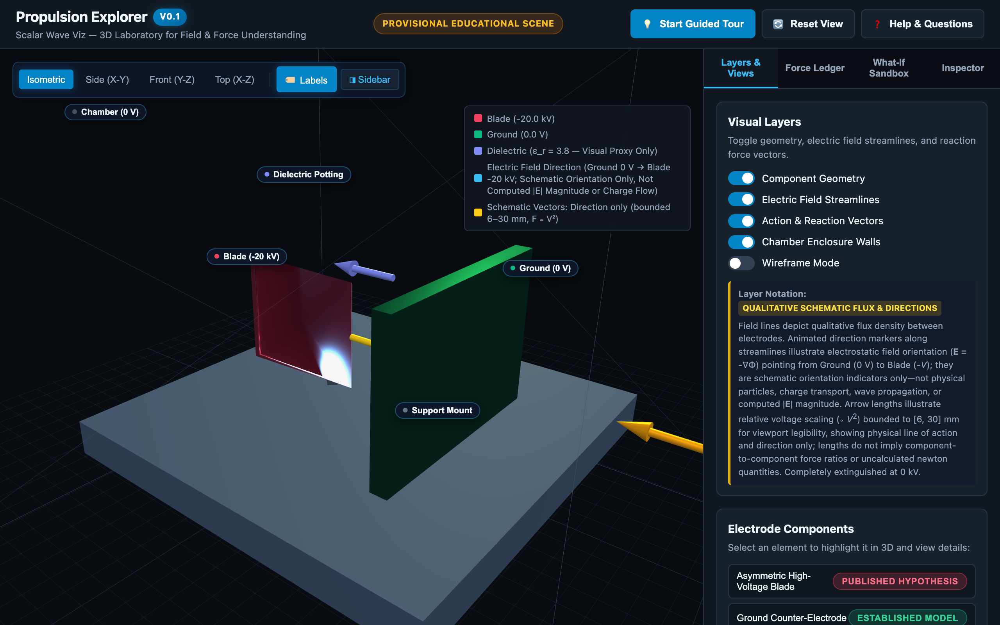

# Scalar Wave Viz

**A visual laboratory for understanding how fields create forces — and exploring whether proposed propulsion devices could actually work.**

Imagine rotating a 3D device, watching electric fields, changing its voltage or materials, and seeing which parts are pushed or pulled. Then ask: **Does the whole device move, or do its internal forces cancel? What would we need to measure to find out?**

That is the goal of Scalar Wave Viz. We are building for curious nonspecialists as well as engineers and scientists. You do **not** need a physics degree to follow or contribute.

> **Reality check:** This is an educational and experimental research project, **not a working propellantless thruster**. It has not demonstrated anomalous propulsion, electrogravitics, a physical exotic scalar wave, or extraordinary moscovium properties. Patent claims and simulations are not proof of thrust.

## What we're building: a Propulsion Explorer

The planned **interactive 3D lab** lets anyone:

1. **See it:** Rotate an apparatus; show electric fields, charge distribution, force arrows, and surrounding supports and walls.
2. **Change it:** Adjust electrode geometry, spacing, voltage and documented material properties; see what the model predicts.
3. **Understand it:** See the forces on **every component** and where momentum goes. Compare conventional physics with clearly identified alternative hypotheses.
4. **Test it:** Find the source and uncertainty behind each result, and learn which controls would distinguish a real effect from ion wind, nearby surfaces, wires or measurement drift.
5. **Plan it:** Eventually export *provisional* dimensions, material requirements, electrical inputs, missing specifications, a bill-of-materials outline, and a controlled test plan — **not a proven propulsion recipe**.

### Visual Explorer V0 / V0.1 / V0.2 — Available Now in Browser

The interactive 3D Propulsion Explorer is runnable directly in your web browser:
- **Nonblocking Three-Panel Layout (V0.2):** Dedicated guided learning panel on the left, unobstructed interactive 3D visualization in the center, and simplified parameter controls and component inspector on the right. Replaces the modal overlay to keep the device fully visible and interactive at all times, with responsive mobile tabs preserving 3D visibility at the top of small viewports.
- **Iceberg Learning Model & Progressive Disclosure (V0.2):** Default plain-English explanations and everyday physical analogies in surface/shallow layers, expandable deeper technical Maxwell stress tensor formulas ($\mathbf{T}_{ij} = \varepsilon_0 (E_i E_j - \frac{1}{2} \delta_{ij} |\mathbf{E}|^2)$) and citations, and research-level competing hypotheses (corona ion wind, chamber wall image coupling) and discriminating null controls.
- **3D Mathematical Scalar Wave Contrast (V0.2 R4):** Dedicated interactive 3D visual contrast alternate view (`#scalar-wave-badge`, `scalarWaveGroup`), demonstrating the geometric and mathematical difference between isotropic, undulating scalar wavefront shells ($\nabla^2\psi - \frac{1}{c^2}\partial_t^2\psi = 0$) and directed electrostatic vector streamlines ($\mathbf{E} = -\nabla\Phi$), mutually exclusive with conventional streamlines, completely isolating the scene by hiding the physical capacitor electrode geometry during wave display, centered in an abstract global reference space with coordinate axes, and strictly qualified as a toy mathematical illustration not coupled to capacitor thrust or novel propulsion.
- **Accessible Semantic Math & Clickable Primary Citations (V0.2 R3):** Accessible, beautifully formatted equations without raw unescaped LaTeX delimiters, accompanied by trusted, clickable deep links to primary patent sections (US11511891B2), canonical textbooks (Jackson, Griffiths, Feynman), and peer-reviewed literature with verified DOIs (Tajmar & Schreiber 2020, *Journal of Electrostatics* 107, 103477).
- **Bidirectional Mobile Ledger Navigation (V0.2 R3):** Seamless mobile navigation buttons (`#btn-chapter4-open-ledger` and `#btn-ledger-back-to-guide`) and unconstrained scrolling ensuring full accessibility across mobile viewports (375px & 390px) without vertical clipping.
- **Rigorous Boundary A Accounting (V0.2 R3):** Clearly distinguishes internal action-reaction cancellation ($\sum \mathbf{F}_{\text{internal}} \equiv \mathbf{0}$) from unverified external chamber wall coupling across the suspended test article boundary (where $\mathbf{F}_{\text{DUT,net}} = \oint_{\partial V_A} \mathbf{T}\cdot\hat{\mathbf{n}}\,dA = \mathbf{F}_{\text{external}}$ is unknown pending calibrated geometry, neither assumed to be zero nor asserted to be non-zero).
- **Six-Chapter Synchronized Journey (V0.2):** Guided curriculum stepping through *Meet the Device* (unenergized 0 V state), *Turn on the Electricity* (-20 kV applied), *Follow the Forces*, *Can the Whole Device Move?* (action-reaction balance), *What Are Scalar Waves?*, and *How Could We Test the Hypothesis?* with dynamic camera framing, synchronized component highlights, and nonblocking callout annotations.
- **Exploration & Tour Controls (V0.2):** Next, Back, Pause/Resume, Reset Tour, and Explore Freely mode allowing unconstrained user inspection at any point.
- **Interactive 3D Geometry:** Orbit, zoom, and inspect an Exodus-inspired single-stage electrode assembly (US11511891B2 FIGS. 4–8) featuring a high-voltage blade cathode (-20 kV), a planar ground counter-electrode (0 V), solid dielectric potting block, grounded chamber walls, and structural insulating mount.
- **Visual Atmosphere & Lighting (V0.1):** Studio laboratory lighting with cool cyan fill for electrode undersides, warm specular rim accents, a dual-zone coordinate ground grid, and a razor-sharp knife-edge apex highlight along the active cathode tip.
- **Dynamic 3D Component Labels (V0.1):** Real-time billboard labels tracking component coordinates in 3D camera space, toggleable with the `L` key or HUD toolbar button, with multi-pass screen-space collision relaxation and deterministic fallback.
- **Animated Schematic Direction Markers (V0.1):** Signed electric field streamlines with animated directional markers demonstrating conventional field orientation ($\mathbf{E} = -\nabla\Phi$) pointing from Ground ($0\text{ V}$) to Blade ($-20\text{ kV}$). Strictly qualified as schematic orientation indicators—not physical charge carriers, wave propagation, or computed $|\mathbf{E}|$ magnitude. Completely extinguished at 0 V.
- **Quick-Select Chip Bar & Full-Screen Mode (V0.1):** 1-click component quick-select toolbar for rapid selection on desktop and touch devices, alongside a full-screen laboratory mode toggling the sidebar (`S` key or HUD button).
- **Occlusion-Free Interior Picking:** Click or hover directly on interior components straight through the outer transparent chamber walls via intelligent raycasting priority, verified across default isometric, Side, and Top views with real canvas pointer interactions.
- **Beginner-Friendly Inspector (V0.1):** Plain-language descriptions of electrode roles, dielectric polarization, and mechanical counter-forces replacing raw internal strings, while preserving exact patent citations and Maxwell stress tensor formulas in expandable details.
- **Action-Reaction Force Ledger:** Structured by physical system boundaries, demonstrating that internal electrostatic forces sum identically to zero across the isolated Device Under Test (Boundary A), while clearly separating external lab environment walls (Boundary B) and the closed universe (Boundary C).
- **The Four Questions Tour:** Guided plain-language walkthrough answering *What am I seeing?*, *Why does it happen?*, *What changes it?*, and *How could we test it?*, rendered with accessible HTML math notation.
- **Honest Provenance & Disclaimers:** Explicitly marked `WHOLE-BODY THRUST: NOT MEASURED / NOT ESTABLISHED`. No unverified thrust claims, zero fabricated force numbers, explicit non-modeled tip radius metadata tag, and accurate patent citations (FIGS. 6B, 21, 23A for dielectric potting).
- **What-If Sandbox:** Explore how voltage ($0 - 50\text{ kV}$, scaling $\propto V^2$), dielectric permittivity (visual material proxy $\varepsilon_r \in [1, 5]$), and surface-to-surface electrode gap ($d \ge 16\text{ mm}$ maintaining $\ge 5.0\text{ mm}$ positive clearance from dielectric potting) alter field gradients, with zero GPU memory leaks verified by instrumented prototype disposal.
- **Accessible & Mobile-First Design (V0.1):** Crash-free keyboard navigation, modal focus trapping, and responsive layouts verified on mobile viewports at 375px (iPhone SE) and 390px (iPhone 12/13/14) with zero horizontal overflow.

[Read the visual-first product vision](docs/PROPULSION_EXPLORER_VISION.md) and [dual-track roadmap](docs/ROADMAP.md).

## Why Exodus? Why scalar waves?

Our first detailed case study is [Exodus Propulsion Technologies](https://ept.space/) and its proposed **asymmetric electrostatic-pressure** effect, especially [patent US11511891B2](https://patents.google.com/patent/US11511891B2/en). An uneven electric field can cause impressive local electrode forces. But **a force on one electrode is not necessarily propulsion**: forces on the supports, other electrodes, power supply, enclosure and environment must be counted too.

This repo also explores **mathematical scalar waves**. That is a *separate* inquiry: a scalar-valued simulation does not demonstrate a new physical scalar field or scalar-wave propulsion. A proposed physical connection needs equations, measurable predictions and an independent test. Known mechanisms such as ion propulsion and ion wind will provide useful visual comparisons.

The question driving the project is **not "How do we prove Exodus is right?"** It is **"What could the effect be, what does established physics already explain, and what experiment could tell the difference?"**

## Two tracks, one goal

| Visual learning experience | Scientific engine |
| --- | --- |
| 3D selectable geometry; field and force layers | Reproducible equations and source-based geometry |
| Intuitive sliders, plain-language explanations | Reliable numerics, uncertainties and boundaries |
| Whole-device momentum illustrations; H0/H1 comparison | Whole-body force ledger, rival hypotheses and controls |
| Provisional prototype and experiment planner | Traceable material properties, missing inputs and safety review |

**Build a useful, clearly labeled educational visualizer early; never describe unverified physics as demonstrated thrust.** Passing tests and attractive plots do not replace physical measurement.

## Project progress — verified November 25, 2026

**2 of 5 independently reviewed scientific phases are accepted.** This is *not* a percentage of product completion or proof of unusual propulsion. Educational visual milestones (Track A) proceed in parallel with scientific remediation (Track B).

- **Track A (Interactive 3D Explorer) — V0, V0.1, V0.2, V1 (OVERALL COMPLETE) & V2 DESIGN SPECIFICATION R4 ACCEPTED AND MERGED ON `main` (`a1990285fcb24d5db0fe177276a522ea19f69650`); SLICE V2-A OWNER-AUTHORIZED FOR DRAFT IMPLEMENTATION; V2-B NOT AUTHORIZED:**
  - **V0 — BASELINE ACCEPTED & MERGED (ROUND 5):** Complete standalone browser application delivered on branch `v0-propulsion-explorer-3d` ([Issue #13](https://github.com/aguacatero/scalar-wave-viz/issues/13), [PR #14](https://github.com/aguacatero/scalar-wave-viz/pull/14)), accepted by ChatGPT independent review V0 R5 at commit `5d8b822e8771dc19a4bf2a27bfc013e3662e03ea` and merged into `main` (`bc3929605300177c3ac26a579930af915c5cebea`).
  - **V0.1 — VISUAL EXPERIENCE & UX POLISH (ACCEPTED & MERGED INTO `main` — ROUND 5):** Branch `feat/v0-1-visual-ux-polish` ([PR #15](https://github.com/aguacatero/scalar-wave-viz/pull/15)), accepted by ChatGPT independent review V0.1 R5 ([pullrequestreview-5816455237](https://github.com/aguacatero/scalar-wave-viz/pull/15#pullrequestreview-5816455237)) at exact code SHA `55da03af781dbc1470a2bd22a7b9dfc93bbf0950` and merged into `main` preserving ancestry (`33a78790dca1c7657b674389183d87b7233cabcc`; integrated `main` CI [Run 43748280974](https://github.com/aguacatero/scalar-wave-viz/actions/runs/43748280974) passed 140 repository tests; source branch preserved).
  - **V0.2 — LEARN PHYSICS BACKWARDS (ACCEPTED — ROUND 6 & MERGED INTO `main`):** Branch `feat/v0-2-learn-physics-backwards` ([Issue #17](https://github.com/aguacatero/scalar-wave-viz/issues/17), [PR #18](https://github.com/aguacatero/scalar-wave-viz/pull/18)), **Accepted for V0.2 Educational Visual Baseline** by ChatGPT independent review V0.2 R6 ([issuecomment-6871100151](https://github.com/aguacatero/scalar-wave-viz/pull/18#issuecomment-6871100151)) at frozen code SHA `634437f70e6b2bdd5b3bd41d6b77cbe551078f05` (0 HIGH, 0 MEDIUM; 157 repository tests passing) and integrated onto `main` at verified SHA `3e1be18cf930eaba9b1f325d70fbf323365b7792` (with V1 Design Spec R5 `fabeb92cff60fd3bcdece3850d767814d8439a59` accepted in [`issuecomment-6898692758`](https://github.com/aguacatero/scalar-wave-viz/pull/18#issuecomment-6898692758)).
  - **V1 — INTERACTIVE SOLVER INTEGRATION (OVERALL COMPLETE — ACCEPTED & MERGED INTO `main`; V1-A R10 + V1-B SLICES B1 R3, B2 R2, B3 R2 & V1-B3 POLISH R2 ALL MERGED):**
    - **V1-A — ACCEPTED AND MERGED (R10 — TRANSPORT & LIFECYCLE BASELINE COMPLETE):** Branch `feat/v1-interactive-solver-integration` ([Issue #19](https://github.com/aguacatero/scalar-wave-viz/issues/19), [PR #20](https://github.com/aguacatero/scalar-wave-viz/pull/20); preserved) was accepted by ChatGPT Independent V1-A Re-Review R10 (`0 HIGH, 0 MEDIUM`, [issuecomment-7031051854](https://github.com/aguacatero/scalar-wave-viz/pull/20#issuecomment-7031051854)) at exact code SHA `9a254a01616e2d273e2d95028fc8e586a2f889dd` (`V1-A-R9-F1` **CLOSED**; `V1-SPEC-R5-I1` **SATISFIED** for V1-A; docs-only closeout HEAD `a206195d500872e7e389f54b3097da9b0f070b9f`), **merged into `main`** under owner authorization in merge commit `f05feeb0f65db98e62410a36943dba93ac93d238` ([CI Run 44684363964](https://github.com/aguacatero/scalar-wave-viz/actions/runs/44684363964): `202` tests), and finalized with post-merge documentation closeout via [PR #21](https://github.com/aguacatero/scalar-wave-viz/pull/21) (`docs/v1-a-merge-closeout`, merged at `a735eac48ed4ce1b4740521578bf6ded3e35730d`; `main` CI [Run 44759903320](https://github.com/aguacatero/scalar-wave-viz/actions/runs/44759903320) `success`).
    - **V1-B SLICE B1 — ACCEPTED AND MERGED (R3 — SOLVER ADAPTERS, SCHEMAS, FINGERPRINTS & WORKER DISPATCH COMPLETE):** Branch `feat/v1-b1-solver-adapter` ([PR #22](https://github.com/aguacatero/scalar-wave-viz/pull/22); preserved) was **ACCEPTED FOR B1 BASELINE (`0 HIGH, 0 MEDIUM`)** by ChatGPT Independent V1-B Slice B1 Re-Review R3 ([pullrequestreview-6002765184](https://github.com/aguacatero/scalar-wave-viz/pull/22#pullrequestreview-6002765184)) at exact source SHA `da8edb024a750f196adb7a82b0a48e1b4c98ce34` (base `a735eac48ed4ce1b4740521578bf6ded3e35730d`; [Push CI Run 44847203447](https://github.com/aguacatero/scalar-wave-viz/actions/runs/44847203447) and [PR CI Run 44847207838](https://github.com/aguacatero/scalar-wave-viz/actions/runs/44847207838) `success` with `214` passing repository tests), **merged into `main`** under owner authorization in merge commit `bdb5c96602d99fc39c05d422be0e58ddc4a4c13e` ([main CI Run 44969830932](https://github.com/aguacatero/scalar-wave-viz/actions/runs/44969830932) `success`), and finalized with post-merge documentation closeout via [PR #23](https://github.com/aguacatero/scalar-wave-viz/pull/23) (`docs/v1-b1-merge-closeout`, merged at `dd0b47508df2bf95bc9c3703fbb780a7dc0b2b12`; `main` CI [Run 44969973915](https://github.com/aguacatero/scalar-wave-viz/actions/runs/44969973915) `success`). All five R1/R2 review findings are **CLOSED** (`V1-B-R1-F1`, `V1-B-R1-F2`, `V1-B-R1-F3`, `V1-B-R2-M1`, `V1-B-R2-M2`).
    - **V1-B SLICE B2 — ACCEPTED AND MERGED INTO `main` (R2 — OFFLINE REFERENCE SNAPSHOTS & CROSS-LANGUAGE PARITY COMPLETE):** Branch `feat/v1-b2-reference-snapshots` ([PR #24](https://github.com/aguacatero/scalar-wave-viz/pull/24); preserved) was **ACCEPTED FOR V1-B SLICE B2 BASELINE (`0 HIGH, 0 MEDIUM, 0 LOW`)** by ChatGPT Independent Re-Review R2 ([pullrequestreview-6012573720](https://github.com/aguacatero/scalar-wave-viz/pull/24#pullrequestreview-6012573720)) at exact accepted source SHA `3a25733790977d1659f5286f4c304fed9c57fb28` ([Push CI Run 44984163324](https://github.com/aguacatero/scalar-wave-viz/actions/runs/44984163324) and [PR CI Run 44984167299](https://github.com/aguacatero/scalar-wave-viz/actions/runs/44984167299) `success`: `218` tests + committed snapshot fidelity gate; docs-only closeout HEAD `5a18ff88e265a7fbe7356c7b79ba0e64c1057921`, [Push CI Run 45031676146](https://github.com/aguacatero/scalar-wave-viz/actions/runs/45031676146) and [PR CI Run 45031680313](https://github.com/aguacatero/scalar-wave-viz/actions/runs/45031680313) `success`), **merged into `main`** under owner authorization in merge commit `7a6c30e1a0961f1f2ffafc594dc3a70fc2e9eed4` ([main CI Run 45078267448](https://github.com/aguacatero/scalar-wave-viz/actions/runs/45078267448) `success`: `218` tests + `--check-committed` fidelity gate + manifest provenance), and finalized with post-merge documentation closeout via [PR #25](https://github.com/aguacatero/scalar-wave-viz/pull/25) (`docs/v1-b2-merge-closeout`, merged at `5f31cc166d6398252a5a5ffdbd5cb00bd84a8dc6`). All three R1 review findings ([pullrequestreview-6010076879](https://github.com/aguacatero/scalar-wave-viz/pull/24#pullrequestreview-6010076879)) are **CLOSED** (`V1-B2-R1-M1`, `V1-B2-R1-M2`, `V1-B2-R1-L1`).
    - **V1-B SLICE B3 — ACCEPTED AND MERGED INTO `main` (R2 — EXPLORER UI INTEGRATION & LIVE LAUNCHER COMPLETE):** Branch `feat/v1-b3-explorer-ui-integration` ([PR #26](https://github.com/aguacatero/scalar-wave-viz/pull/26); preserved) was **ACCEPTED FOR V1-B SLICE B3 BASELINE (`0 HIGH, 0 MEDIUM; 1 non-blocking LOW follow-up B3-R2-L1`)** by ChatGPT Independent Re-Review R2 ([pullrequestreview-6016233670](https://github.com/aguacatero/scalar-wave-viz/pull/26#pullrequestreview-6016233670)) at exact accepted source SHA `b849784edba7f71f7a8e061bc0d6c9dca43ccd39` ([Push CI Run 45102550193](https://github.com/aguacatero/scalar-wave-viz/actions/runs/45102550193) and [PR CI Run 45102554680](https://github.com/aguacatero/scalar-wave-viz/actions/runs/45102554680) `success`: `228` tests + `--check-committed` fidelity gate + manifest provenance), **merged into `main`** under owner authorization in merge commit `4f0cdb72d49fc94afa1fc43bb452efaec8ded322` ([main CI Run 45106437680](https://github.com/aguacatero/scalar-wave-viz/actions/runs/45106437680) `success`), and finalized with post-merge documentation closeout via [PR #27](https://github.com/aguacatero/scalar-wave-viz/pull/27) (`docs/v1-b3-merge-closeout`, merged at `cf09dcc4e3cec3f650bd6fd4d93338ce2956db34`). All three R1 review findings ([pullrequestreview-6015433165](https://github.com/aguacatero/scalar-wave-viz/pull/26#pullrequestreview-6015433165)) are **CLOSED** (`B3-R1-F1`, `B3-R1-F2`, `B3-R1-F3`):
      1. **Supported Live V1-B Solver Launcher ([run_v1_solver.py](run_v1_solver.py), `B3-R1-F1` CLOSED):** Dedicated IPv4-loopback user-facing CLI launcher invoking accepted B1 `v1_solver_adapter.create_solver_server` for live arbitrary 1D and 2D P0/P1 solves (`python run_v1_solver.py`), while preserving accepted V1-A `run_explorer.py` untouched for V1-A lifecycle tests and updating offline UI guidance to reference `python run_v1_solver.py`.
      2. **1D Analytic, 2D Grounded-Box & Coordinated View-Transition Controls ([explorer/v1_solver_ui.js](explorer/v1_solver_ui.js), [explorer/index.html](explorer/index.html), [explorer/explorer.css](explorer/explorer.css), [explorer/explorer.js](explorer/explorer.js)):** Adds a `V1 Solver` panel switching between the provisional 3D Exodus schematic (`PROVISIONAL ILLUSTRATIVE SCENE`), validated 1D ideal parallel-plate controls (`ESTABLISHED MODEL`, exact `0.0 N` net pair force, virtual-work cross-check, fringing warning), and validated 2D grounded-box controls (`ESTABLISHED MODEL`, 3 presets × `n ∈ {41, 81, 101}`, dynamic Section 3.2 gap/`c_y` bounds, live probe inspection including `NON_VACUUM`, full 6-component `N/m` force budget, honest coarse `n=41` `UNBALANCED_EXCEEDS_TOLERANCE` banner, and `(41, 81, 101)` convergence study with `NOT_COMPUTED_NONUNIFORM_H_RATIO` order suppression). Enforces Section 4.2 synchronous pre-debounce invalidation unconditionally across every chapter, Chapter 5 wave-entry/exit, and `Explore Freely` transition regardless of `solveState` (`B3-R1-F2` & `B3-R1-F3` CLOSED), `150 ms` debounce + `AbortController` + shared staleness gates, truthful `SOLVER BRIDGE OFFLINE` fallback across `file://` and static `http.server` with locked arbitrary 2D controls, dedicated 2D cross-section `<canvas id="v1-2d-canvas">` hiding 3D `forceGroup`, explicit `#slider-eps` `VISUAL PROXY ONLY` invariance, and full preservation of all 6 Iceberg chapters.
      3. **V1-B3 Polish R2 — ACCEPTED AND MERGED INTO `main` (`fix/v1-b3-r2-l1-schematic-transition`, [PR #28](https://github.com/aguacatero/scalar-wave-viz/pull/28); source branch preserved):** **ACCEPTED FOR V1-B3 POLISH R2 SCOPED BASELINE (`0 HIGH, 0 MEDIUM, 0 LOW`)** by ChatGPT Independent Re-Review R2 ([pullrequestreview-6034826478](https://github.com/aguacatero/scalar-wave-viz/pull/28#pullrequestreview-6034826478)) at frozen accepted implementation SHA `3a3da7d2eef6126326c9ac96587d590b69b5cd65` ([Push CI Run 45332374699](https://github.com/aguacatero/scalar-wave-viz/actions/runs/45332374699) and [PR CI Run 45332380788](https://github.com/aguacatero/scalar-wave-viz/actions/runs/45332380788) `success`; docs-only closeout HEAD `3f0838ab47e745fa822c3c49368226d313e541c3`, [Push CI Run 45343392380](https://github.com/aguacatero/scalar-wave-viz/actions/runs/45343392380) and [PR CI Run 45343400124](https://github.com/aguacatero/scalar-wave-viz/actions/runs/45343400124) `success`), **merged into `main`** under owner authorization in merge commit `8d3f36fc510fabdb0b0724ce9b241733a83657be` ([integrated main CI Run 45544290369](https://github.com/aguacatero/scalar-wave-viz/actions/runs/45544290369) `success`: `229` tests + `--check-committed` fidelity gate + manifest provenance), and finalized with post-merge closeout [PR #29](https://github.com/aguacatero/scalar-wave-viz/pull/29) (`3519e409e60c126ca724f9b2bf2bf360a0855592`; `main` CI [Run 45547040079](https://github.com/aguacatero/scalar-wave-viz/actions/runs/45547040079) `success`). Findings **`B3-R2-L1`**, **`V1-B3-POLISH-R1-M1`**, and **`V1-B3-POLISH-R1-L1`** are **CLOSED**: isolates Chapter 5 scalar-wave contrast across all prior solver modes (`schematic_3d`, `1D`, `2D`) by showing a truthful wave status panel, hiding/disabling 1D and 2D panels and blocking input-triggered `/api/v1/solve` or `/api/v1/study` requests during wave mode, cleanly exiting wave mode on explicit `setMode()` selection, and verifying desktop (`1280×860`) and mobile (`390×844`) transitions past the `150 ms` debounce window (`240 ms`) in [tests/test_v1_browser_smoke.py](tests/test_v1_browser_smoke.py). Preserves frozen P0/P1 kernels, accepted V1 Spec R5, accepted V1-A/B1/B2/B3 baselines, committed snapshot fidelity, manifest provenance, isolated Track B P2 ([Draft PR #11](https://github.com/aguacatero/scalar-wave-viz/pull/11)), and explicit `WHOLE-BODY THRUST: NOT MEASURED / NOT ESTABLISHED`.
  - **V2 — WHOLE-DEVICE FORCE STORY (DESIGN SPECIFICATION R4 ACCEPTED & MERGED INTO `main` VIA [PR #31](https://github.com/aguacatero/scalar-wave-viz/pull/31); SLICE V2-A OWNER-AUTHORIZED FOR DRAFT IMPLEMENTATION; V2-B NOT AUTHORIZED):** Tracked in [Issue #30](https://github.com/aguacatero/scalar-wave-viz/issues/30) (open for V2-A & V2-B). Design specification [docs/V2_FORCE_STORY_SPEC.md](docs/V2_FORCE_STORY_SPEC.md) (frozen accepted git blob `7d4b66be574b937f3750d135f351d3b1e6e3f142` at exact reviewed SHA `375c7d2be9fba41e7d29ab028a6cd0149a8b3fb7`, docs closeout `5142379022132d12079c78f67b977211047bef6d`) received **ACCEPTED FOR V2 DESIGN SPECIFICATION R4 (`0 HIGH, 0 MEDIUM, 0 LOW`)** in [ChatGPT Independent R4 Review #6068853886](https://github.com/aguacatero/scalar-wave-viz/pull/31#pullrequestreview-6068853886) (closing all 12 R1/R2/R3 findings) and was **merged into `main`** under explicit owner authorization in merge commit `a1990285fcb24d5db0fe177276a522ea19f69650` ([integrated main CI Run 45763384342](https://github.com/aguacatero/scalar-wave-viz/actions/runs/45763384342) `success`: `229` tests + `--check-committed` + manifest provenance; branch `feat/v2-whole-device-force-story-spec` preserved). Preserves strict unit/context separation (`1D: N`, `2D: N/m`, `3D Exodus: PENDING_SCIENTIFIC_ACCEPTANCE`), zero P2 leakage, and `WHOLE-BODY THRUST: NOT MEASURED / NOT ESTABLISHED`. Slice V2-A is owner-authorized for draft implementation; V2-B remains unauthorized.
- **Track B (Scientific Acceptance Gates) — 2 OF 5 ACCEPTED:**
  - **P0 — ACCEPTED AND MERGED:** Conventional electrostatics baseline, [PR #5](https://github.com/aguacatero/scalar-wave-viz/pull/5).
  - **P1 — ACCEPTED AND MERGED:** Numerical validation and force accounting, [PR #10](https://github.com/aguacatero/scalar-wave-viz/pull/10). Accepted R11 scientific SHA `2a87abd0f8de873899f541d521d303d0f4462954`; **merged** in main commit `8e1fdb32655d073002ae5a794b08e48f19a78a0f`.
  - **P2 — ACTIVE DRAFT, NOT SCIENTIFICALLY ACCEPTED:** Exodus geometry and H0/H1 comparison in [Issue #7](https://github.com/aguacatero/scalar-wave-viz/issues/7), [Draft PR #11](https://github.com/aguacatero/scalar-wave-viz/pull/11). The [independent R9 review](https://github.com/aguacatero/scalar-wave-viz/pull/11#issuecomment-6568647224) concluded `CHANGES REQUIRED — P2 R9 SCIENTIFIC BASELINE NOT ACCEPTED` (findings tracked for R10: full-length FIG. 21 refinement, domain sensitivity bounds, 3D dielectric virtual work benchmark, multi-body discretization extrapolation, and missing-term reporting). P2 remains separate from V0/V0.2/V1/V2, draft and unmerged.
  - **P3 — PENDING:** Physical scalar-field and nuclear hypotheses with traceable evidence and falsifiable predictions.
  - **P4 — PENDING SCIENTIFIC GATE:** Final validated research dashboard.

**Next user-facing milestone:** Deliver **Slice V2-A** draft implementation (H0/H1/H2 comparison surfaces, Boundary A/B/C signed ledgers, V1→V2 transport-epoch synchronization & pending-work settlement, lossless `{ n, reason }` study provenance, and required contract/Playwright tests per frozen [docs/V2_FORCE_STORY_SPEC.md](docs/V2_FORCE_STORY_SPEC.md), [Issue #30](https://github.com/aguacatero/scalar-wave-viz/issues/30)) for independent ChatGPT V2-A R1 review. **Next scientific milestone:** resolve P2's independent R10 findings ([Draft PR #11](https://github.com/aguacatero/scalar-wave-viz/pull/11)). Completing Track A visual milestones does not advance the Track B P2/P3/P4 scientific gates or establish whole-body propulsion.

**Standing Antigravity rule:** At the start and end of every substantive implementation session, inspect and synchronize the README with live GitHub status. Any substantive repository change must carry its README update in the **same branch/PR**, including plain-English status and next steps. A no-change review should still explicitly verify the README without fabricating an update. Follow [AGENTS.md](AGENTS.md#mandatory-readme-progress-synchronization--every-project-update). This rule does not itself run a background scheduler.

## How you can support the project

**Curious learners:** tell us which images or explanations would help you understand the forces. **Frontend and 3D developers:** contribute interactive scenes, sliders, accessibility and diagrams. **Physicists and numerical researchers:** check assumptions, force accounting and convergence. **Experimentalists and hardware engineers:** critique material specifications, confounding effects, uncertainty and safe measurement designs.

Start with the [visual product vision](docs/PROPULSION_EXPLORER_VISION.md) and [open GitHub issues](https://github.com/aguacatero/scalar-wave-viz/issues); open an issue to ask a question, suggest a feature, challenge a claim or offer expertise. Null results and constructive criticism are welcome.

## What already runs

### 3D Propulsion Explorer (V0 / V0.1 / V0.2 / V1) — Browser Laboratory

Launch with the **live validated P0/P1 V1 solver bridge** (supports arbitrary live 1D and 2D solves on `127.0.0.1`):

    python run_v1_solver.py

Or launch the V0.2 3D Explorer over the V1-A transport-only server (automatically falls back to bundled B2 offline reference snapshots for V1):

    python run_explorer.py

This starts a lightweight local HTTP server and automatically opens `http://127.0.0.1:8000` in your default browser. No build steps, Node packages, or Jupyter notebooks required.

Alternatively, serve statically with Python's standard library (offline snapshot mode):

    python -m http.server 8000 --directory explorer

Or open `explorer/index.html` directly in any modern browser (`file://` serverless offline mode with vendored Three.js and bundled B2 reference snapshots).

### First reproducible conventional-electrostatics baseline

This new code deliberately separates an **analytic ideal parallel-plate benchmark** from a **2D field calculation for cylindrical electrodes inside a grounded outer enclosure**. The examples do **not** reproduce a particular Exodus patent embodiment, do not calculate device thrust and do not show any anomalous propulsion.

Run from repository root:

    python -m pip install -r requirements.txt
    python -m unittest discover -s tests -v
    python examples/electrostatics_demo.py

The exported electrostatics_baseline.png displays (A) potential in V, (B) electric field in kV/m, and (C) signed local opposing forces in µN for a **separate ideal parallel-plate case**. In that ideal case net pair force is **0 N**. The grounded box in the 2D example is an **external conductor**; it does not approximate an isolated device with free-space boundaries.

Read: [Scientific charter](docs/SCIENCE_CHARTER.md) · [Exodus comparison contract](docs/EXODUS_MODEL_CONTRACT.md) · [Roadmap](docs/ROADMAP.md).

### Preview without opening Jupyter

Open the latest successful [Physics baseline tests workflow](https://github.com/aguacatero/scalar-wave-viz/actions/workflows/physics-tests.yml), then download the artifact named **conventional-electrostatics-preview**. The file `electrostatics_baseline.png` contains three labeled panels, and it is **not** a measurement or a patent-specific thrust prediction. GitHub retains the generated CI artifact for 30 days.

## Existing notebooks — illustrative, not experimentally verified

- [wave_3d.ipynb](wave_3d.ipynb): a 3D *mathematical* scalar wave simulation, with user-selected relative material wave speeds Air=1, Bismuth=0.55, Moscovium=0.15, metamaterial=0.04. **These values are hypothetical presets**, not established material responses. The toy equation has independently reviewed numerical checks, but the more extreme hypothetical material speed presets remain under-resolved and cannot support physical material claims.
- [mc_stability.ipynb](mc_stability.ipynb): exploratory nuclear stability and synthesis charts. Hypothetical Mc-291–299 half-lives and the isotope-mass-to-wave-speed interpolation are **not derived by the software** from measured data or validated model predictions.
- [wave_demo.ipynb](wave_demo.ipynb): educational wave examples; one saved output contains a Matplotlib error.

[Legacy Binder demo](https://mybinder.org/v2/gh/aguacatero/scalar-wave-viz/HEAD?filepath=wave_3d.ipynb) (compatibility and physics not validated).

## Scientific standards and project references

[Scientific charter](docs/SCIENCE_CHARTER.md) · [Exodus comparison contract](docs/EXODUS_MODEL_CONTRACT.md) · [Visual product vision](docs/PROPULSION_EXPLORER_VISION.md) · [Roadmap](docs/ROADMAP.md) · [Agent operating rules](AGENTS.md).

Every scientific output must distinguish **established models**, **published hypotheses**, **what-if inputs**, **experimental measurements** and **unverified numerical results**, with sources, units, boundary conditions, and uncertainty. **A scientifically sound null result is progress.**
