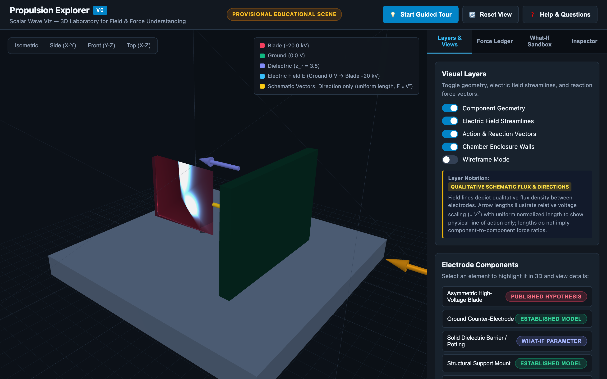

# Scalar Wave Viz

**A visual laboratory for understanding how fields create forces — and exploring whether proposed propulsion devices could actually work.**

Imagine rotating a 3D device, watching electric fields, changing its voltage or materials, and seeing which parts are pushed or pulled. Then ask: **Does the whole device move, or do its internal forces cancel? What would we need to measure to find out?**

That is the goal of Scalar Wave Viz. We are building for curious nonspecialists as well as engineers and scientists. You do **not** need a physics degree to follow or contribute.

> **Reality check:** This is an educational and experimental research project, **not a working propellantless thruster**. It has not demonstrated anomalous propulsion, electrogravitics, a physical exotic scalar wave, or extraordinary moscovium properties. Patent claims and simulations are not proof of thrust.

## What we're building: a Propulsion Explorer

The planned **interactive 3D lab** lets anyone:

1. **See it:** Rotate an apparatus; show electric fields, charge distribution, force arrows, and surrounding supports and walls.
2. **Change it:** Adjust electrode geometry, spacing, voltage and documented material properties; see what the model predicts.
3. **Understand it:** See the forces on **every component** and where momentum goes. Compare conventional physics with clearly identified alternative hypotheses.
4. **Test it:** Find the source and uncertainty behind each result, and learn which controls would distinguish a real effect from ion wind, nearby surfaces, wires or measurement drift.
5. **Plan it:** Eventually export *provisional* dimensions, material requirements, electrical inputs, missing specifications, a bill-of-materials outline, and a controlled test plan — **not a proven propulsion recipe**.

### Visual Explorer V0 — Available Now in Browser

The first working version (**V0**) of the 3D Propulsion Explorer is runnable directly in your web browser:
- **Interactive 3D Geometry:** Orbit, zoom, and inspect an Exodus-inspired single-stage electrode assembly (US11511891B2 FIGS. 4–8) featuring a high-voltage blade cathode (-20 kV), a planar ground counter-electrode (0 V), solid dielectric potting block, and grounded chamber walls.
- **Occlusion-Free Interior Picking:** Click or hover directly on interior components (blade, ground plate, dielectric potting, structural mount) straight through the outer transparent chamber walls via intelligent raycasting priority.
- **Dynamic Field & Force Layers:** Switch between component geometry, signed electric field streamlines ($0\text{ V} \to -20\text{ kV}$) with color-coded $|\mathbf{E}|$, zero-voltage field extinction, and uniform schematic action-reaction force vectors ($F \propto V^2$).
- **The Four Questions Tour:** Guided plain-language walkthrough answering *What am I seeing?*, *Why does it happen?*, *What changes it?*, and *How could we test it?*, rendered with accessible HTML math notation.
- **Action-Reaction Force Ledger:** Structured by physical system boundaries, demonstrating that internal electrostatic forces sum identically to zero across the isolated Device Under Test (Boundary A), while clearly separating external lab environment walls (Boundary B) and the closed universe (Boundary C).
- **Honest Provenance & Disclaimers:** Explicitly marked `WHOLE-BODY THRUST: NOT MEASURED / NOT ESTABLISHED`. No unverified thrust claims, zero fabricated force numbers, and accurate patent citations (FIGS. 6B, 21, 23A for dielectric potting).
- **What-If Sandbox:** Explore how voltage ($0 - 50\text{ kV}$, scaling $\propto V^2$), permittivity ($\varepsilon_r \in [1, 5]$), and collision-bounded electrode spacing ($\ge 16\text{ mm}$ maintaining $\ge 3.0\text{ mm}$ positive clearance from dielectric) alter field gradients, with zero GPU memory leaks on slider drag.
- **Accessible & Responsive Design:** Crash-free keyboard navigation, modal focus trapping, and responsive layout verified on mobile screens down to 375px. Tested with automated browser smoke suite.

[Read the visual-first product vision](docs/PROPULSION_EXPLORER_VISION.md) and [dual-track roadmap](docs/ROADMAP.md).

## Why Exodus? Why scalar waves?

Our first detailed case study is [Exodus Propulsion Technologies](https://ept.space/) and its proposed **asymmetric electrostatic-pressure** effect, especially [patent US11511891B2](https://patents.google.com/patent/US11511891B2/en). An uneven electric field can cause impressive local electrode forces. But **a force on one electrode is not necessarily propulsion**: forces on the supports, other electrodes, power supply, enclosure and environment must be counted too.

This repo also explores **mathematical scalar waves**. That is a *separate* inquiry: a scalar-valued simulation does not demonstrate a new physical scalar field or scalar-wave propulsion. A proposed physical connection needs equations, measurable predictions and an independent test. Known mechanisms such as ion propulsion and ion wind will provide useful visual comparisons.

The question driving the project is **not "How do we prove Exodus is right?"** It is **"What could the effect be, what does established physics already explain, and what experiment could tell the difference?"**

## Two tracks, one goal

| Visual learning experience | Scientific engine |
| --- | --- |
| 3D selectable geometry; field and force layers | Reproducible equations and source-based geometry |
| Intuitive sliders, plain-language explanations | Reliable numerics, uncertainties and boundaries |
| Whole-device momentum illustrations; H0/H1 comparison | Whole-body force ledger, rival hypotheses and controls |
| Provisional prototype and experiment planner | Traceable material properties, missing inputs and safety review |

**Build a useful, clearly labeled educational visualizer early; never describe unverified physics as demonstrated thrust.** Passing tests and attractive plots do not replace physical measurement.

## Project progress — verified November 2, 2026

**2 of 5 independently reviewed scientific phases are accepted.** This is *not* a percentage of product completion or proof of unusual propulsion. Educational visual milestones (Track A) proceed in parallel with scientific remediation (Track B).

- **Track A (Interactive 3D Explorer) — V0 R3 REMEDIATED & READY FOR INDEPENDENT RE-REVIEW:**
  - **V0 — FIRST WORKING 3D EXPLORER (ROUND 3):** Complete standalone browser application delivered on branch `v0-propulsion-explorer-3d` ([Issue #13](https://github.com/aguacatero/scalar-wave-viz/issues/13), [Draft PR #14](https://github.com/aguacatero/scalar-wave-viz/pull/14)). Remediated all findings from ChatGPT independent re-review V0 R2 (`pullrequestreview-5739337831`):
    - `V0-R2-F1`: Implemented occlusion-free interior picking (`getPickedObject`) that prioritizes blade, ground, dielectric, and mount through the outer transparent chamber walls.
    - `V0-R2-M1`: Resized dielectric potting to 16 mm width centered at x=3 mm and set gap slider minimum to 16 mm, guaranteeing $\ge 3.0\text{ mm}$ positive physical clearance across the full slider range $[16, 50]\text{ mm}$; synchronized blade dimensions `{30.0, 25.4, 3.0, 0.1}` between provenance JSON and Three.js mesh.
    - `V0-R2-M2`: Corrected dielectric patent citation to `US11511891B2, FIGS. 6B, 21, 23A; col. 7 lines 30–55` (dielectric potting) and rejected FIG. 7 (force vectors).
    - `V0-R2-M3`: Built companion automated browser smoke test suite (`tests/test_v0_browser_smoke.py`) using Playwright against real Chromium; added Playwright to CI workflow; recaptured all 6 visual assets with all layers visibly active.
    - `V0-R2-M4`: Replaced disparate arrow constants with uniform normalized base length (`UNIFORM_ARROW_BASE_LEN = 18.0`) scaling identically as $18.0 \times (V/20)^2$, strictly depicting action/reaction directions without uncomputed relative force ratios.
    - `V0-R2-M5`: Implemented recursive `disposeHierarchy(root)` eliminating GPU geometry and material leaks on slider drags.
    - Verification: 28 unit tests passing; 8 browser smoke tests passing; 108 total tests passing across repo.
- **Track B (Scientific Acceptance Gates) — 2 OF 5 ACCEPTED:**
  - **P0 — ACCEPTED AND MERGED:** Conventional electrostatics baseline, [PR #5](https://github.com/aguacatero/scalar-wave-viz/pull/5).
  - **P1 — ACCEPTED AND MERGED:** Numerical validation and force accounting, [PR #10](https://github.com/aguacatero/scalar-wave-viz/pull/10). Accepted R11 scientific SHA `2a87abd0f8de873899f541d521d303d0f4462954`; **merged** in main commit `8e1fdb32655d073002ae5a794b08e48f19a78a0f`.
  - **P2 — ACTIVE DRAFT, NOT SCIENTIFICALLY ACCEPTED:** Exodus geometry and H0/H1 comparison in [Issue #7](https://github.com/aguacatero/scalar-wave-viz/issues/7), [Draft PR #11](https://github.com/aguacatero/scalar-wave-viz/pull/11). The [independent R9 review](https://github.com/aguacatero/scalar-wave-viz/pull/11#issuecomment-6566089334) concluded `CHANGES REQUIRED — P2 R9 SCIENTIFIC BASELINE NOT ACCEPTED` (findings tracked for R10: full-length FIG. 21 refinement, domain sensitivity bounds, 3D dielectric virtual work benchmark, multi-body discretization extrapolation, and missing-term reporting). P2 remains separate from V0, draft and unmerged.
  - **P3 — PENDING:** Physical scalar-field and nuclear hypotheses with traceable evidence and falsifiable predictions.
  - **P4 — PENDING SCIENTIFIC GATE:** Final validated research dashboard.

**Next user-facing milestone:** expand V0 into V1 with direct solver-bound recalculation and scenario presets. **Next scientific milestone:** resolve P2's independent R10 findings. Neither is claimed complete.

**Standing Antigravity rule:** At the start and end of every substantive implementation session, inspect and synchronize the README with live GitHub status. Any substantive repository change must carry its README update in the **same branch/PR**, including plain-English status and next steps. A no-change review should still explicitly verify the README without fabricating an update. Follow [AGENTS.md](AGENTS.md#mandatory-readme-progress-synchronization--every-project-update). This rule does not itself run a background scheduler.

## How you can support the project

**Curious learners:** tell us which images or explanations would help you understand the forces. **Frontend and 3D developers:** contribute interactive scenes, sliders, accessibility and diagrams. **Physicists and numerical researchers:** check assumptions, force accounting and convergence. **Experimentalists and hardware engineers:** critique material specifications, confounding effects, uncertainty and safe measurement designs.

Start with the [visual product vision](docs/PROPULSION_EXPLORER_VISION.md) and [open GitHub issues](https://github.com/aguacatero/scalar-wave-viz/issues); open an issue to ask a question, suggest a feature, challenge a claim or offer expertise. Null results and constructive criticism are welcome.

## What already runs

### 3D Propulsion Explorer (V0) — Browser Laboratory

Run the zero-friction local launcher from repository root:

    python run_explorer.py

This starts a lightweight local HTTP server and automatically opens `http://127.0.0.1:8000` in your default browser. No build steps, Node packages, or Jupyter notebooks required.

Alternatively, serve with Python's standard library:

    python -m http.server 8000 --directory explorer

Or open `explorer/index.html` directly in any modern browser (offline capability with vendored Three.js).

### First reproducible conventional-electrostatics baseline

This new code deliberately separates an **analytic ideal parallel-plate benchmark** from a **2D field calculation for cylindrical electrodes inside a grounded outer enclosure**. The examples do **not** reproduce a particular Exodus patent embodiment, do not calculate device thrust and do not show any anomalous propulsion.

Run from repository root:

    python -m pip install -r requirements.txt
    python -m unittest discover -s tests -v
    python examples/electrostatics_demo.py

The exported electrostatics_baseline.png displays (A) potential in V, (B) electric field in kV/m, and (C) signed local opposing forces in µN for a **separate ideal parallel-plate case**. In that ideal case net pair force is **0 N**. The grounded box in the 2D example is an **external conductor**; it does not approximate an isolated device with free-space boundaries.

Read: [Scientific charter](docs/SCIENCE_CHARTER.md) · [Exodus comparison contract](docs/EXODUS_MODEL_CONTRACT.md) · [Roadmap](docs/ROADMAP.md).

### Preview without opening Jupyter

Open the latest successful [Physics baseline tests workflow](https://github.com/aguacatero/scalar-wave-viz/actions/workflows/physics-tests.yml), then download the artifact named **conventional-electrostatics-preview**. The file `electrostatics_baseline.png` contains three labeled panels, and it is **not** a measurement or a patent-specific thrust prediction. GitHub retains the generated CI artifact for 30 days.

## Existing notebooks — illustrative, not experimentally verified

- [wave_3d.ipynb](wave_3d.ipynb): a 3D *mathematical* scalar wave simulation, with user-selected relative material wave speeds Air=1, Bismuth=0.55, Moscovium=0.15, metamaterial=0.04. **These values are hypothetical presets**, not established material responses. The toy equation has independently reviewed numerical checks, but the more extreme hypothetical material speed presets remain under-resolved and cannot support physical material claims.
- [mc_stability.ipynb](mc_stability.ipynb): exploratory nuclear stability and synthesis charts. Hypothetical Mc-291–299 half-lives and the isotope-mass-to-wave-speed interpolation are **not derived by the software** from measured data or validated model predictions.
- [wave_demo.ipynb](wave_demo.ipynb): educational wave examples; one saved output contains a Matplotlib error.

[Legacy Binder demo](https://mybinder.org/v2/gh/aguacatero/scalar-wave-viz/HEAD?filepath=wave_3d.ipynb) (compatibility and physics not validated).

## Scientific standards and project references

[Scientific charter](docs/SCIENCE_CHARTER.md) · [Exodus comparison contract](docs/EXODUS_MODEL_CONTRACT.md) · [Visual product vision](docs/PROPULSION_EXPLORER_VISION.md) · [Roadmap](docs/ROADMAP.md) · [Agent operating rules](AGENTS.md).

Every scientific output must distinguish **established models**, **published hypotheses**, **what-if inputs**, **experimental measurements** and **unverified numerical results**, with sources, units, boundary conditions, and uncertainty. **A scientifically sound null result is progress.**
