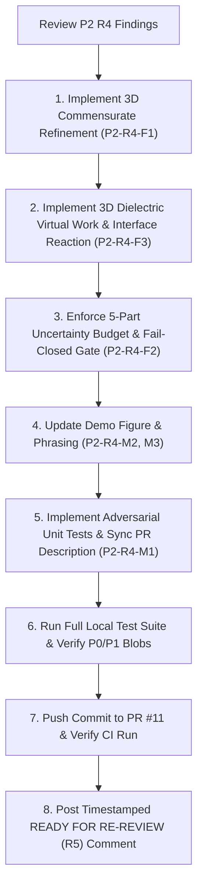

# SCALAR WAVE VIZ — Phase P2 R5 Remediation Plan

**Repository:** `aguacatero/scalar-wave-viz` · **Draft PR #11 / Issue #7**  
**Governing Review:** [ChatGPT Independent Scientific Re-Review P2 R4 (issuecomment-6548110642)](https://github.com/aguacatero/scalar-wave-viz/pull/11#issuecomment-6548110642)  
**Disposition:** CHANGES REQUIRED — P2 R4 NOT ACCEPTED  
**Operating Mode:** MANUAL-ONLY (PR #11 stays DRAFT / OPEN / UNMERGED; no P3 kickoff)

---

## 1. Overview & Objectives

In review round R4, ChatGPT verified all 115 tests passing, P0 baseline blob preservation (`97f65dfa25db7730323edd5e52c98b17371fdeaa`), manifest provenance, and positive progress in 3D wall traction and 2D virtual-work cross-checks. However, three blocking HIGH findings and three MEDIUM findings preclude scientific baseline acceptance.

This remediation plan executes full mechanical and scientific fixes for all 6 findings.

---

## 2. Detailed Findings & Remediation Actions

### Finding P2-R4-F1 (HIGH) — 3D Fixed-Geometry Refinement Sequence & Multi-Body Convergence
- **Issue:** Single 3D solve used commensurate $h_0 = 1.27\text{ mm}$, but `run_3d_mesh_convergence_study` defaulted to non-commensurate $(2.0, 1.5, 1.2)\text{ mm}$, rounding the $1.27\text{ mm}$ blade to $2.0, 1.5, 1.2\text{ mm}$ (ratios $1.575, 1.181, 0.945$), re-creating geometry distortion. Richardson extrapolation forced $p=1$ and extrapolated blade only.
- **Remediation:**
  1. Reconfigure `run_3d_mesh_convergence_study` with exact commensurate subdivisions: $h_k = 1.27\text{ mm} / k$ ($k=1, 2, 3$).
  2. Maintain actual-to-target geometry ratios $= 1.0000$ at all refinement levels (blade thickness = $k$ cells, height = $5k$ cells, gap = $5k$ cells, pitch = $5k$ cells, ground width = $40k$ cells, $z$ extent $= 50.8\text{ mm}$).
  3. At every refinement level, compute and report:
     - 3D blade force ($F_{\text{blade}}$)
     - 3D ground force ($F_{\text{ground}}$)
     - 3D dielectric force ($F_{\text{dielectric}}$)
     - 3D enclosure direct wall force ($F_{\text{wall}}$)
     - 3D net system momentum residual ($F_{\text{net}}$)
     - H1 surface quantities ($\oint E^2 dA$, etc.)
  4. Compute 3D observed convergence order $p_{\text{obs}}$ (or flag non-asymptotic status when singular or sub-half-order).
  5. Report multi-body force differences and domain stability.
  6. Quantify 3D discretization uncertainty at the $237\ \mu\text{N}$ experimental scale.

### Finding P2-R4-F2 (HIGH) — Strict Discrimination Gate Enforcing Declared 5-Part Uncertainty Budget
- **Issue:** Gate tested only $|F_{\text{net}}| < 23.7\ \mu\text{N}$ and relative closure $< 0.5\%$, ignoring mesh, domain, and model uncertainties. Discretization was estimated from 2D (18%), clearance was hardcoded (50 µN), and model uncertainty was only a string.
- **Remediation:**
  1. Structure the 5-part uncertainty budget with evaluated numerical bounds:
     - $u_{\text{solver}}$: linear algebra solver residual ($|F_{\text{blade}}| \times \epsilon_{\text{cg}}$)
     - $u_{\text{closure}}$: discrete momentum closure residual ($|F_{\text{net}}|$)
     - $u_{\text{mesh}}$: 3D mesh discretization uncertainty from the 3D refinement study ($|F_{\text{fine}} - F_{\text{extrap}}|$ or $|F_k - F_{k-1}|$)
     - $u_{\text{domain}}$: domain boundary clearance uncertainty from clearance sweep
     - $u_{\text{model}}$: numerical model parameter uncertainty (corner singularity fillet sensitivity bound)
  2. Compute combined uncertainty bounds:
     - RSS combined: $U_{\text{rss}} = \sqrt{\sum u_i^2}$
     - Conservative linear bound: $U_{\text{linear}} = \sum u_i$
  3. Define strict fail-closed acceptance rule for `physical_scale_discrimination_status`:
     - Requires $u_{\text{closure}} < 23.7\ \mu\text{N}$
     - AND each individual uncertainty ($u_{\text{mesh}}, u_{\text{domain}}, u_{\text{model}}) < 23.7\ \mu\text{N}$
     - AND $U_{\text{rss}} < 23.7\ \mu\text{N}$
     - AND `whole_body_3d_mechanical_accounting` is verified.
     - If ANY term is $\ge 23.7\ \mu\text{N}$ or unverified, fail closed (`NOT_RESOLVED_AT_CURRENT_3D_GRID_RESOLUTION`).
  4. Align `finite_3d_is_conserved` consistently with the discrimination gate.
  5. Add adversarial injection tests confirming fail-closed behavior when closure is small but uncertainty is large.

### Finding P2-R4-F3 (HIGH) — Independent 3D Dielectric Reaction & Virtual Work Validation
- **Issue:** 2D dielectric benchmark did not validate 3D FIG.21 reaction; 3D code set $F_{\text{dielectric}} = F_{\text{article}} - (F_{\text{blade}} + F_{\text{ground}})$, making whole-body accounting identity-based.
- **Remediation:**
  1. Implement `benchmark_analytic_planar_dielectric_slab_force_3d`:
     - Analytical virtual work: $F_{\text{analytic}} = -0.5 \varepsilon_0 (\varepsilon_r - 1) (V^2 / d) L_z$
     - 3D numerical virtual work perturbation: $F_{\text{vw}} = \frac{U_e(x_0+\delta x) - U_e(x_0-\delta x)}{2\delta x}$ with constant voltage sources ($+\partial U_e / \partial x$)
     - 3D Maxwell stress contour integral $F_{\text{contour}}$
     - 3D direct Korteweg-Helmholtz interface / material traction: $\int -\frac{1}{2} \varepsilon_0 |\mathbf{E}|^2 \nabla \varepsilon_r dV$
  2. In `solve_exodus_electrostatics_3d`:
     - Compute direct 3D interface traction and compare against contour difference.
     - Retain `whole_body_3d_mechanical_accounting = "UNVERIFIED_PENDING_CONFORMING_INTERFACE_MESHING"` and fail closed in the discrimination gate.
     - For vacuum, explicitly designate `"VACUUM_NO_DIELECTRIC"`.

### Finding P2-R4-M1 (MED) — Correct Test Count & Metadata Assertions
- **Issue:** `docs/PR_DESCRIPTION.md` and PR #11 body stated 116 tests; actual CI was 115.
- **Remediation:**
  1. Correct `docs/PR_DESCRIPTION.md` and live PR #11 body to exact suite count.
  2. Implement dynamic test suite assertion that queries the test loader rather than relying on stale text strings.

### Finding P2-R4-M2 (MED) — Provisional 2D and 3D Singularity Convergence Phrasing
- **Issue:** Phrasing claimed measured $p_{\text{obs}}$ "confirmed" singularity governance rather than "consistent with".
- **Remediation:**
  1. Update phrasing to "consistent with a corner-singularity-influenced convergence rate".
  2. Label 2D and 3D observed-order extrapolation as explicitly provisional (`is_provisional = True`).

### Finding P2-R4-M3 (MED) — Dynamic Bar Chart Labels in Demo Plot
- **Issue:** `examples/exodus_patent_demo.py` hard-coded `"Net (683 µN)"` and `"Blade (h0=1.27mm)"`.
- **Remediation:**
  1. Dynamically build labels from model fields: `f"Finite 3D Approx\nNet ({abs(f3d.finite_3d_net_system_force_x_n)*1e6:.0f} µN)"`.
  2. Add regression test confirming labels update dynamically under parameter changes.

---

## 3. Execution Sequence

